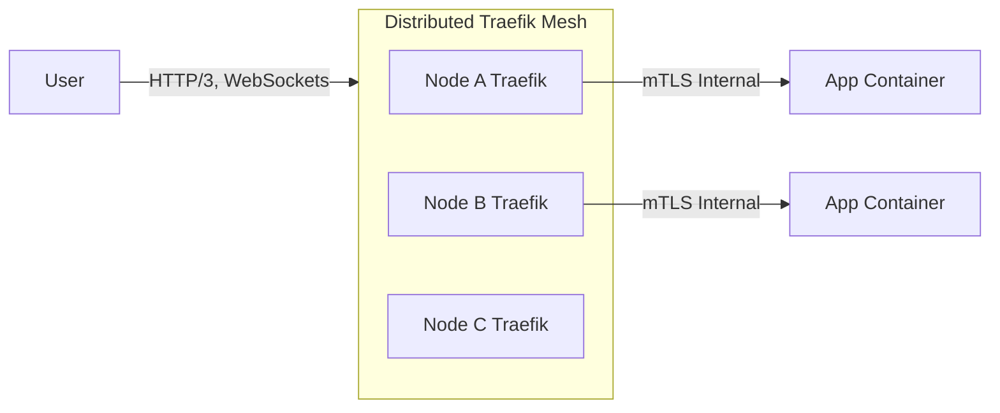
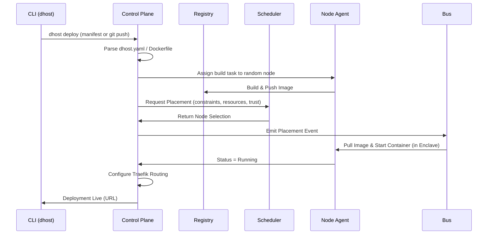
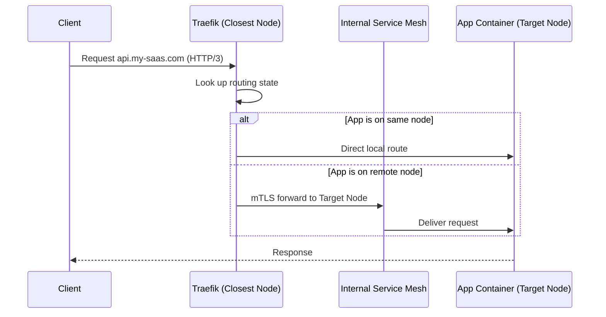
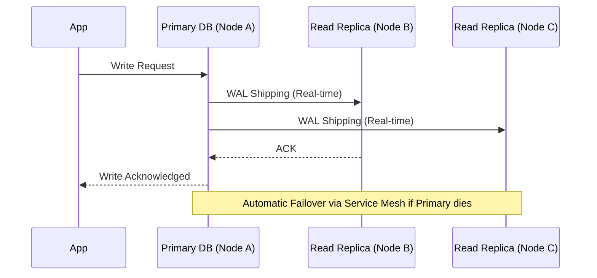
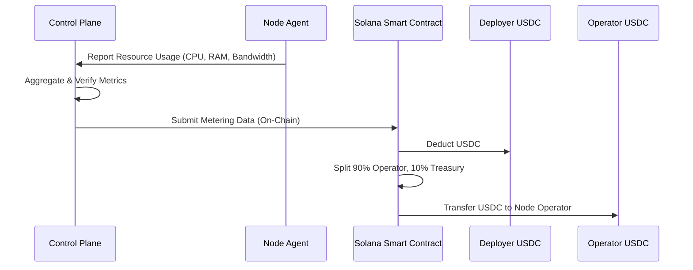

# Decentralized.Host 2030 Architecture

## 1. Core Architecture

Decentralized.Host 2030 is a sovereign distributed compute fabric. It is designed to be a self-hosted, decentralized hosting and compute platform that provides zero-friction deployment, intelligent multi-dimensional scheduling, hardware-rooted node trust, and an optional sovereign economic layer powered by Solana.

### 1.1. Core Technologies
- **Core language**: Rust (control plane, scheduler, node agent, edge proxy), Python (FastAPI API layer, ML glue), TypeScript (dashboard UI).
- **Node agent**: Single Rust binary (< 20MB). Runs Docker Engine (or containerd) + Traefik + Fluent Bit + OTel Collector.
- **Control plane**: FastAPI (Python) + PostgreSQL (Citus or CockroachDB for distributed scale) + NATS (event bus) + Traefik (API routing).
- **Registry**: Local Docker registry (`distribution/docker-registry`), with optional integrations for GHCR, ECR, GCR.
- **Confidential computing**: Intel TDX / AMD SEV-SNP (CPU), NVIDIA CC (GPU), with gVisor as a user-space fallback.
- **Blockchain**: Solana Anchor (Rust) smart contracts using USDC for stablecoin settlement.

### 1.2. Hardware Requirements
- **Minimum per node**: 4-core CPU, 8GB RAM, 50GB SSD, 1Gbps network.
- **Recommended per node**: 8-core CPU, 32GB RAM, 200GB NVMe SSD, 10Gbps network.
- **GPU node**: 1x NVIDIA A100/H100 or AMD MI300X, 8-core CPU, 64GB RAM.
- **Operating System**: Ubuntu 22.04/24.04, Debian 12, Rocky Linux 9 (Docker-compatible; Windows supported for CLI/Dashboard only).

## 2. Component Diagrams

### 2.1. System Overview

```mermaid
graph TD
    subgraph Control Plane
        API[FastAPI API Layer]
        DB[(PostgreSQL + Citus / CockroachDB)]
        Bus[NATS Message Bus]
        Scheduler[Intelligent Mesh Scheduler]
        UI[Local Web Dashboard]
    end

    subgraph Node Agent
        NA[Rust Node Agent]
        Runtime[Docker / Containerd]
        Traefik[Traefik Edge Proxy]
        Enclave[Confidential Enclave TDX/SEV-SNP]
        Observability[Fluent Bit + OTel]
    end

    subgraph Credit System (Solana)
        SmartContract[Anchor Smart Contracts]
        Wallet[USDC / SOL]
    end

    API --> DB
    API --> Bus
    Scheduler --> Bus
    Bus --> NA
    NA --> Runtime
    Runtime --> Enclave
    NA --> Traefik
    NA --> Observability
    API --> SmartContract
    UI --> API
```

### 2.2. Distributed Edge Fabric (DEF)



## 3. Data Flow Diagrams

### 3.1. Deployment Lifecycle (`dhost deploy`)



### 3.2. Traffic Routing



### 3.3. Data Replication (PostgreSQL Example)



### 3.4. Credit Settlement (Solana Mainnet)



## 4. Threat Model

Decentralized.Host 2030 operates on a zero-trust model, assuming that any node in the mesh may be compromised, malicious, or located in a hostile jurisdiction.

- **Node Compromise**: Addressed via Hardware Attestation and Confidential Computing (Intel TDX / AMD SEV-SNP). Node operators cannot read or tamper with container memory or encrypted storage. Data at rest is encrypted (AES-256) with tenant-derived keys.
- **Data Exfiltration**: Prevented by mandatory mTLS for all inter-node traffic. Data inside the enclave remains encrypted until in use.
- **Supply Chain Attacks**: All container images in the registry must be signed (cosign/sigstore) and scanned for high-severity CVEs (Trivy/Grype). Unsigned or vulnerable images are rejected by nodes.
- **DDoS Attacks**: The distributed nature of the Traefik edge acts as a natural mitigation. Configurable rate-limiting, anomaly detection (shifting traffic off nodes experiencing traffic spikes), and challenge-responses (JS challenge) are applied.
- **Insider Threat**: Addressed by Role-Based Access Control (RBAC) and immutable, hash-chained audit logs.
- **Regulatory Risks**: Addressed by Jurisdiction-Aware Deployment. Deployments can be pinned to specific geographic regions or constrained to omit crypto (Solana) interactions depending on local laws.

## 5. `dhost.yaml` Specification

`dhost.yaml` is the complete declarative manifest for Decentralized.Host 2030 applications.

```yaml
name: "app-name"
version: "2.1.0"

services:
  - name: "service-name"
    image: "registry-path/image:tag"
    build: "./context-path" # Path to Dockerfile
    ports: [8080] # Exposed ports
    env:
      KEY: "VALUE"
      SECRET: "${secrets:secret_name}"
      DB_URL: "${services:db:5432}"
    resources:
      cpu: "2" # Dedicated cores
      memory: "4Gi" # Hard limit
    scaling:
      min: 1
      max: 10
      metric: "cpu" # cpu, memory, queue_depth
      threshold: "80%"
    health_check:
      path: "/healthz"
      interval: "10s"
      timeout: "3s"
      retries: 3

databases:
  - name: "db-name"
    engine: "postgresql" # postgresql, redis, rabbitmq, mongodb
    version: "16"
    size: "10Gi"
    replicas: 2
    backup:
      schedule: "0 3 * * *"
      retention: "14d"

secrets:
  - name: "secret_name"
    source: "vault" # vault, env, file, generate
    key: "path/to/key"

routing:
  - host: "app.example.com"
    service: "service-name"
    tls: true

networking:
  internal: true # Enable internal service mesh
  egress:
    allowed: ["api.stripe.com"] # Egress whitelist

observability:
  logs: "structured"
  metrics: "prometheus"
  tracing: "otel"

scheduling:
  affinity:
    - "service-name must be on same node as db-name"
  node_selector:
    - "gpu: true"
    - "region: ap-south"
  anti_affinity:
    - "no two replicas of service-name on same node"
```

## 6. Scheduling Algorithm Specification

The Intelligent Mesh Scheduler (IMS) evaluates available nodes based on multi-dimensional scoring, scheduling constraints, and continuous live load rebalancing.

1.  **Filtering**: Nodes that do not meet hard constraints are discarded (e.g., `gpu: true`, strict `affinity`, hardware limits, missing required Trust Score).
2.  **Multi-Dimensional Scoring**: Remaining nodes are scored based on:
    *   **CPU & Memory Availability**: Preference for lower utilization.
    *   **Disk I/O**: Available IOPS capacity.
    *   **Network & Latency**: Lowest average latency to associated services (affinity).
    *   **Trust Score**: Nodes with a higher historical uptime and data integrity score receive higher priority, especially for stateful DB workloads.
    *   **Cost**: Lowest required USDC per-resource cost.
3.  **Live Rebalancing**: If a node exceeds thresholds (e.g., CPU > 80% for 5 mins), the scheduler gracefully drains and migrates lower-priority or highly mobile stateless containers to less-loaded nodes.

## 7. Node Attestation Specification

- **Hardware Root of Trust**: Nodes utilize TPM 2.0, Secure Enclave, Intel SGX, or AMD SEV to generate a cryptographic keypair at first boot.
- **Remote Attestation**: Before joining the mesh, the node agent submits a Remote Attestation Report to the Control Plane proving hardware legitimacy and untampered firmware/OS.
- **Continuous Verification**: Nodes must re-attest every 24 hours. A failure in attestation results in immediate quarantine.
- **Trust Score**: Continuously computed from 0 to 1.0, based on:
  - 30-day and 90-day Uptime.
  - Data integrity hash verifications.
  - Latency jitter.
  - Patch level and attestation status.

## 8. Confidential Computing Specification

- **Enclave Lifecycle**: Containers are deployed strictly inside hardware-isolated enclaves (Intel TDX / AMD SEV-SNP for CPU, NVIDIA CC for GPU). Memory is encrypted via hardware keys inaccessible to the hypervisor/host OS.
- **Key Management**: Encryption keys are split using Shamir's Secret Sharing across multiple nodes, with a mandatory 90-day automatic rotation cycle.
- **Multi-Tenant Isolation**: Tenant A's enclave is cryptographically isolated from Tenant B's enclave on the same node. The node operator cannot inspect network traffic, storage, or memory of any hosted tenant.

## 9. Credit System Specification

The Sovereign Economic Layer is optional (private meshes are free). For open networks, it is powered by Solana Mainnet.

- **Unit of Account**: USDC (stablecoin), avoiding native token volatility. 1 credit = $0.01.
- **Smart Contracts**: Solana Anchor programs handle resource metering, payments, SLA enforcement, and dispute resolution.
- **Metering**: The Control Plane aggregates container metrics (CPU-hours, RAM-hours, GB-transferred) and submits them on-chain.
- **Settlement**: Deployers pay in USDC. Smart contracts automatically split payouts: 90% to the Node Operator, 10% to the Network Treasury.
- **SLA Enforcement**: If node uptime drops below 99%, the smart contract automatically withholds the operator's payment.
- **AI Agent Native**: Autonomous agents holding USDC wallets can query the mesh, deploy endpoints, and pay for compute without human intervention.

## 10. Edge Fabric Specification

The Distributed Edge Fabric (DEF) replaces centralized CDNs.

- **Traefik Mesh**: Every node runs Traefik. Routing state is shared via the Control Plane with sub-second propagation.
- **Protocols**: HTTP/3 (QUIC) by default, native WebSocket/SSE support, and native gRPC.
- **Geographic Routing**: Requests route to the lowest-latency node running the target service or caching the static asset.
- **DDoS Protection**: Per-IP, per-endpoint, and per-tenant rate-limiting (default 100 req/s per IP). Anomaly detection automatically triggers stricter limits and challenges (Proof-of-Work/JavaScript) during traffic spikes.

## 11. Database Management Specification

Databases are first-class citizens in the mesh.

- **Provisioning**: Managed deployments of PostgreSQL, Redis, RabbitMQ, MongoDB, etc., configured directly via `dhost.yaml`.
- **Replication**: Configurable read replicas across different geographic regions via real-time WAL shipping.
- **Automatic Failover**: Handled via internal service mesh sidecars routing to promoted replicas in < 30s.
- **Backups**: Automatic, daily encrypted backups (AES-256) stored on off-mesh S3 endpoints or distinct nodes.
- **Point-In-Time-Recovery (PITR)**: Restorable up to 7 days via WAL logs.

## 12. Observability Specification

Observability is built-in; no external stack (Grafana/Loki) is required to be configured by the user.

- **Metrics**: Native Prometheus-compatible metrics for every node, container, and service.
- **Logs**: Fluent Bit aggregates structured JSON logs across the mesh. Retained for 30 days.
- **Traces**: Auto-instrumented OpenTelemetry for Python, Go, Node.js, Rust, and Java.
- **SLO Tracking**: Automatic P99 latency and availability burn-rate alerting.
- **Cost Tracking**: Real-time dashboards displaying per-node and per-app cost (CPU/RAM-hours, USDC spend).

## 13. Multi-Tenancy Specification

- **Hardware Isolation**: Enabled via Confidential Computing enclaves ensuring Tenant A cannot see Tenant B's data or processes.
- **RBAC**: Simple, per-environment roles: Owner, Admin, Developer, Viewer.
- **Audit Logs**: Immutable, hash-chained, tamper-evident logs stored in the Control Plane DB tracking every CLI/API action (Who, What, When).
- **Jurisdiction-Aware Scheduling**: Enables legal compliance by pinning workloads to specific regions or disabling crypto interactions.

## 14. 24-Month Build Roadmap

The roadmap to Decentralized.Host 2030 is structured across 4 phases, focusing on security, scale, and the economic layer.

### Phase 1: Core Mesh & Observability (Months 1-6)
- **Goal**: Harden the MVP for production stability.
- **Milestones**:
  - Rewrite Control Plane with distributed DB support (PostgreSQL + Citus).
  - Replace polling with NATS message bus.
  - Implement full built-in Observability stack (Prometheus metrics, Fluent Bit logs, OTel tracing).
  - Implement `dhost.yaml` declarative manifest parsing and deployment.

### Phase 2: Zero-Trust & Confidential Computing (Months 7-12)
- **Goal**: Implement multi-tenancy and hardware-rooted trust.
- **Hardware Gates**: Requires procurement of nodes with TPM 2.0 and Intel TDX / AMD SEV-SNP.
- **Milestones**:
  - Implement Hardware Remote Attestation and Trust Score computation.
  - Launch gVisor user-space isolation fallback.
  - Launch full Hardware Enclave support for CPU and GPU workloads.
  - Implement encrypted inter-node Service Mesh (mTLS).

### Phase 3: Data & Stateful Services (Months 13-18)
- **Goal**: Reliable, automated stateful workload management.
- **Milestones**:
  - Implement managed PostgreSQL provisioning and WAL shipping.
  - Implement automatic backups, verification, and PITR.
  - Introduce distributed edge DDoS protection and advanced geographic routing.
  - Release internal RBAC and tamper-evident audit logs.

### Phase 4: Sovereign Economy & Mainnet (Months 19-24)
- **Goal**: Optional global economic layer.
- **Dependency Gates**: Solana mainnet throughput and RPC 2.0 readiness.
- **Milestones**:
  - Write and audit Solana Anchor smart contracts.
  - Launch USDC-backed stablecoin settlement layer.
  - Implement on-chain resource metering and automatic SLA enforcement.
  - Launch AI Agent Native deployment and payment APIs.
